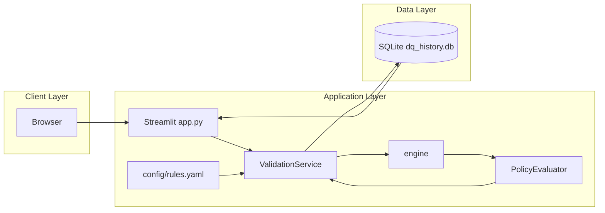
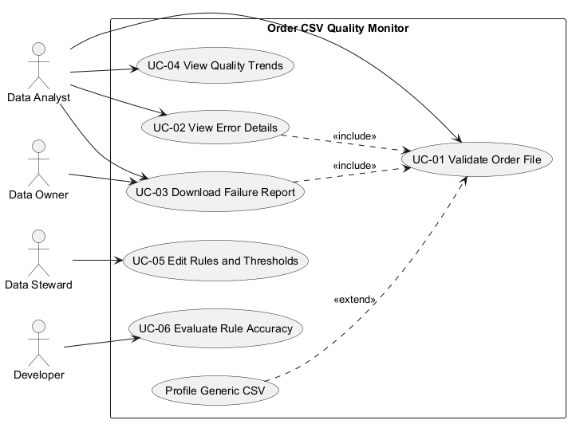
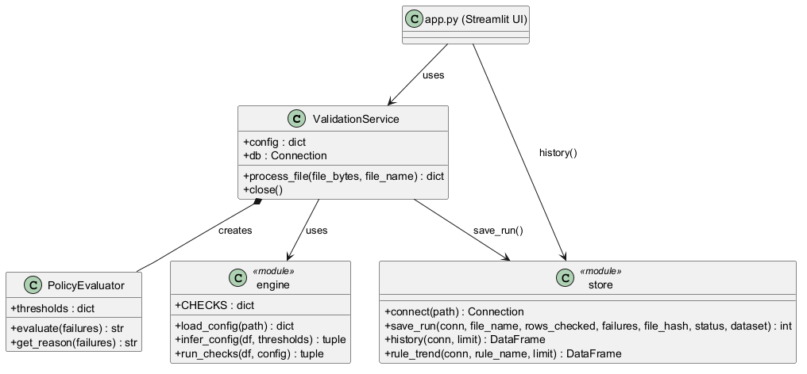
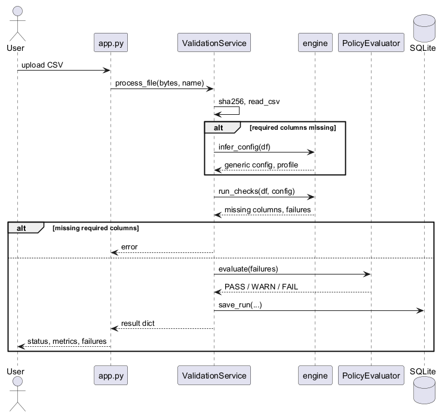
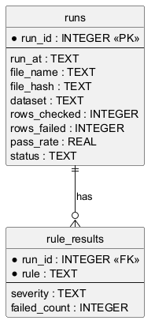

# บทที่ 3
# การออกแบบระบบ (System Design)

## 3.1 สถาปัตยกรรมระบบ (System Architecture)

ระบบ Order CSV Quality Monitor ใช้สถาปัตยกรรมแบบ **Three-Tier Architecture** โดยแยกส่วนการแสดงผล ส่วนประมวลผล และส่วนจัดเก็บข้อมูลออกจากกัน ได้แก่:

1.  **Client Layer (Frontend):** ผู้ใช้เข้าถึงผ่าน Browser โดยหน้าจอสร้างด้วย Streamlit (`app.py`) ประกอบด้วย 3 แท็บ ได้แก่ Validate, History และ Evaluation
2.  **Application Layer (Backend):** ส่วนประมวลผลหลักเขียนด้วย Python แบ่งเป็นโมดูลในแพ็กเกจ `dq/`
    *   `service.py` — ประสานงานทั้งกระบวนการ (อ่านไฟล์ → ตรวจสอบ → ตัดสินผล → บันทึก)
    *   `engine.py` — ตรวจสอบข้อมูลตามกฎ และสร้างกฎอัตโนมัติสำหรับ CSV ทั่วไป
    *   `policy.py` — ตัดสินผล PASS / WARN / FAIL จากเกณฑ์ (thresholds)
    *   `config/rules.yaml` — นิยามกฎและเกณฑ์ โดยไม่ต้องแก้โค้ด
3.  **Data Layer (Database):** จัดเก็บประวัติการตรวจสอบใน SQLite (`dq_history.db`) ผ่าน `store.py`

**การไหลของข้อมูล (Data Flow):**
User (Browser) → Streamlit (`app.py`) → `ValidationService` → `engine` → `PolicyEvaluator` → `store` → SQLite

แผนภาพสถาปัตยกรรมแบบละเอียดอยู่ใน [diagrams.md](./diagrams.md)

---

## 3.2 ความต้องการของระบบ (System Requirements)

### 3.2.1 ความต้องการด้านฟังก์ชัน (Functional Requirements)
*   **FR-01 Upload CSV:** อัปโหลดไฟล์ CSV และรับผลการตรวจสอบทันที
*   **FR-02 Order Validation:** ไฟล์ที่มีคอลัมน์ `order_id`, `order_date`, `amount` ใช้กฎที่กำหนดไว้ (missing_id, duplicate_id, invalid_date, invalid_amount)
*   **FR-03 Generic CSV Profiling:** ไฟล์อื่นๆ ถูกวิเคราะห์โปรไฟล์คอลัมน์ และสร้างกฎจากเนื้อหาอัตโนมัติ
*   **FR-04 Severity & Policy:** แบ่งระดับ critical / warning และตัดสินผลเป็น PASS / WARN / FAIL
*   **FR-05 Failure Report:** แสดงแถวที่มีปัญหาและดาวน์โหลดรายงานเป็น CSV
*   **FR-06 History Tracking:** บันทึกทุกการตรวจสอบและแสดงแนวโน้ม Pass Rate
*   **FR-07 Evaluation:** วัด Precision / Recall / F1 กับชุดข้อมูลที่มีเฉลย (standard และ hard set)
*   **FR-08 Configurable Rules:** ปรับกฎและเกณฑ์ผ่านไฟล์ YAML

### 3.2.2 ความต้องการด้านอื่นๆ (Non-Functional Requirements)
*   **NFR-01 Maintainability:** แยกโมดูลตามหน้าที่ และมีชุดทดสอบ pytest (19 tests)
*   **NFR-02 Traceability:** เก็บ SHA-256 ของไฟล์และเวลาที่ตรวจในทุกการรัน
*   **NFR-03 Portability:** ทำงานได้บน Windows / Linux / Mac และ Streamlit Community Cloud
*   **NFR-04 Scalability of display:** จำกัดการแสดงผลสูงสุด 2,000 แถว และให้ดาวน์โหลดรายงานฉบับเต็มแทน

---

## 3.3 การออกแบบหน้าจอ (Screen Design)

### 3.3.1 แท็บ Validate
อัปโหลด CSV แสดงสถานะ (PASS/WARN/FAIL) จำนวนแถวที่ตรวจ แถวที่มีปัญหา และจำนวน critical พร้อมกราฟสรุปตามกฎ ตารางแถวที่ต้องตรวจสอบ และปุ่มดาวน์โหลดรายงาน สำหรับไฟล์ทั่วไปจะมีตารางโปรไฟล์คอลัมน์และกฎที่อนุมานได้

### 3.3.2 แท็บ History
แสดงจำนวนการรันทั้งหมด Pass Rate ล่าสุดและค่าเฉลี่ย ตารางประวัติ และกราฟแนวโน้ม Pass Rate

### 3.3.3 แท็บ Evaluation
แสดง Macro Precision / Recall / F1 และตารางผลรายกฎ พร้อมคำอธิบายการตีความ

---

## 3.4 การออกแบบแผนภาพระบบ (System Diagrams)

### 3.4.1 แผนภาพกรณีการใช้งาน (Use Case Diagram)

*(รูปที่ 3.2 แผนภาพ Use Case)*

### 3.4.2 แผนภาพคลาส (Class Diagram)

*(รูปที่ 3.3 แผนภาพคลาส)*

### 3.4.3 แผนภาพลำดับ (Sequence Diagram)

*(รูปที่ 3.4 ลำดับการตรวจสอบไฟล์)*

### 3.4.4 แผนภาพ ER

*(รูปที่ 3.5 แผนภาพ ER ของฐานข้อมูล)*

ต้นฉบับ PlantUML (`.puml`) อยู่ในโฟลเดอร์เดียวกัน แผนภาพ Mermaid เพิ่มเติมอยู่ใน [diagrams.md](./diagrams.md) และรายละเอียด Use Case อยู่ใน [use_cases.md](./use_cases.md)

---

## 3.5 การออกแบบฐานข้อมูล (Database Design)

*   **runs** — สรุปแต่ละการรัน: `run_id, run_at, file_name, file_hash, dataset, rows_checked, rows_failed, pass_rate, status`
*   **rule_results** — จำนวนความล้มเหลวต่อกฎต่อการรัน: `run_id, rule, severity, failed_count`

ความสัมพันธ์: `runs` 1 : N `rule_results`

---

## 3.6 แนวทางการ Deploy

*   **Local:** `streamlit run app.py`
*   **Streamlit Community Cloud:** ใช้ `streamlit_app.py` เป็นไฟล์หลัก (SQLite จะรีเซ็ตเมื่อแอปรีสตาร์ท)
*   **CI:** GitHub Actions รัน pytest และ `evaluate.py` ทุกครั้งที่ push
